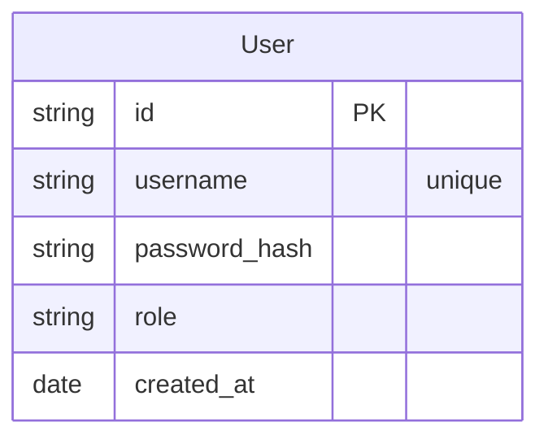
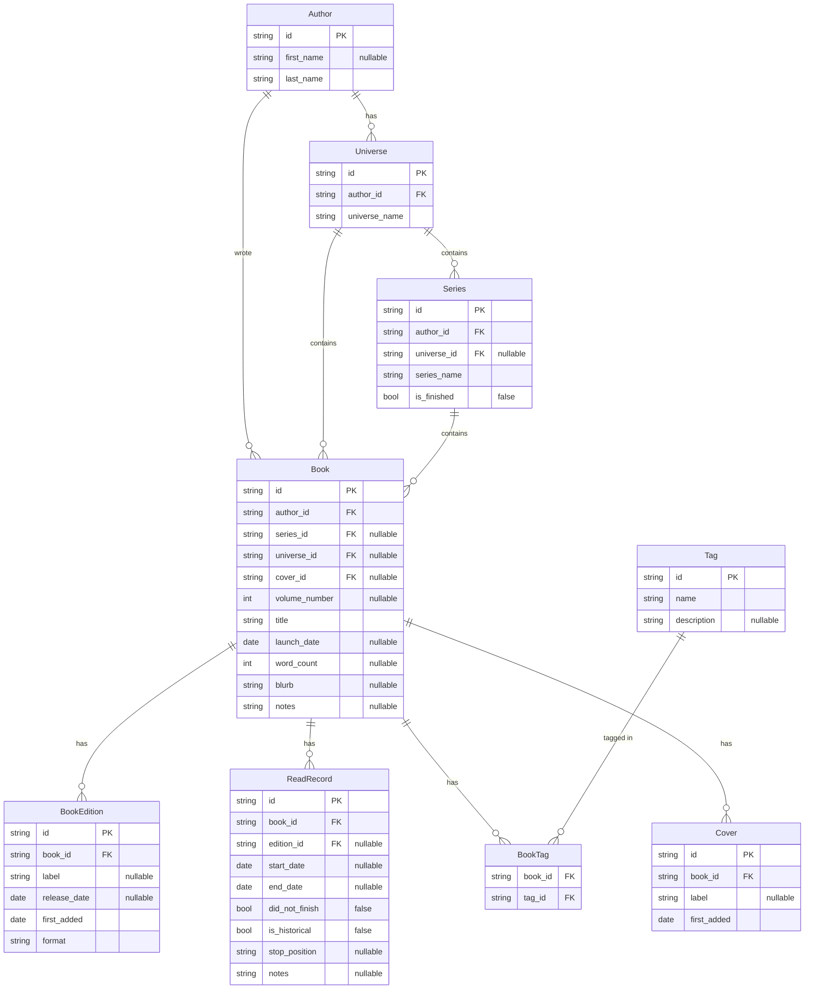

# Database Model

for the database, the chosen solution is PostgreSQL, mainly because it allows the use of schema-per-tenant. the reason for this choice is that it separates the data for users and simplifies the structure of the tables, eliminating the need for user ID field for each row. because the project was designed with the idea of each user / small group of users having their own server instead of a gigantic centralized server hosting all the information, the downside of having to migrate every schema individually is something we find acceptable for a simpler mental model and separation of information.

> name = for things with a canonical identity independent of the user (author, universe, series)
> label = free-text the user attaches to a specific instance

## Database structure

because of the schema-per-tenant approach, for storing the user's credentials a shared schema in required with a single table:


when a request comes, you check the shared schema and retrieve the user's ID, then use it to connect to the proper schema (`user_{id}`) and query it for the required data. the user's schema has the following tables:



> in table `Series`, if for an entry `universe_id` is set, then `Series.author_id` and `Universe.author_id` must match.

this is the table structure for the database. the following table are of special interest:
- `Book` = represents the abstract record of a book, meaning it's not tied to a specific edition of format. it holds the information that is shared between the different editions, and is the common link between these said editions. the `launch_date` represents the date the first edition of the book has been launched.
- `BookEdition` = an extension of the `Book`, contains the information that makes that edition different from the book. `label` is some text the user attaches to the edition. `release_date` is the date the edition was released, different from the book launch date.
- `ReadRecord` = represents a read pass of an edition of a book. each edition can have multiple read passes. if the record has the `start_date` set as null, it means that the read is historical - the user does not remember when they read it. an edition cannot have multiple historical read records, and a read record cannot have the start date null and the end date set. `stop_position` is a catch-all field where users can save anything that will help them know where they stopped reading.
- `BookTag` = links a tag to a book.

## Database-derived logic

### Read status

each book has a read status, based on the read records it's editions have gathered. the status can be `UNREAD`, `IN PROGRESS`, `DNF` and `READ`. because the status can be derived from the already-existing data in the database, it will not have a separate entry in the `Book` table. a book can be `IN PROGRESS` but also already read once; in this case an indicator should be added to show the number of reads and inform the user that the book has been read multiple times.

a **historical read** is a special kind of read record that marks the edition as having been read, but without setting a `start_date`/`end_date` value, mainly because the user might not remember when they read the book. there is a limit of one historic read per book, so there needs to be a check in place that verifies no other read records with no dates exist.

> because the historical reads do not have a start and end date, the UI should not show the date selectors for this kind of reads. the DNF option is still available. the server should still validate that the dates are null for historical reads. 

the process of determining the state of the book is:
- if there are no records, the book is `UNREAD`.
- if there are records:
	- if there is a record without an `end_date` set:
		- if there are no other records with `end_date` set and `dnf = false`, the book is `IN PROGRESS` (if there are records with `dnf = true` it means the user abandoned/paused the read, but because they are currently reading it they do not matter).
		- if there are records with `end_date` set and `dnf = false`, the book is `IN PROGRESS` but it was read multiple times. the read count can be determined by counting the records that are complete and have the `dnf = false`.
	- if there are only records with `end_date` set:
		- if there is a record with `dnf = true`:
			- if there are complete records with `dnf = false`, then the book has been abandoned during a re-read, but it retains the `READ` status.
			- if there are no complete records, then the book is `DNF`.
		- if all records have `end_date` set and `dnf = false`, then the book is `READ` and the read count can be found out based on these records.
	- if there is only the historic record, the book is `READ`.

### Files on disk

for saving both covers and editions to disk, the chosen solution is to implement a system that allows relevant information to be stored in filenames while also maintaining the link to the database entry, by placing the ID of the record in the filename. a filename will look like this:
```
Last, First Name - Universe - Series - 00 - Title - edition.ID.extension
```

this structure allows the retention of information in case something happens to the database; the user will be able to recover their files without having to play detective and open each one of them. by embedding th ID of the record we ensure in case the fields in the record change, the book can be retrieve from the filesystem.

because of the schema-per-tenant, each user will have their own base directory in which the editions and the covers will be saved:
```
|- user_1
    |- editions
    |- covers
|- user_2
    |- editions
    |- covers
```

when adding a record that includes a file, for that file to be saved the record needs to first be saved in the DB and have an ID generated, otherwise the file save will fail or be corrupted because no ID exists to be embedded in the filename. in case the DB write is successful but the file save is not, the changes to the DB should be rolled back to keep the DB and the disk in sync.

when a edition is deleted or it's record is modified in such a way that is should trigger a modification in the filename, this job should be handled by a periodic task, not immediate. this is done in order to not have multiple redundant modifications to the same file in a short time for efficiency reasons, and also because it's not vital to the integrity of the system. this reconciliation job should run at specified interval (6/12/24 hours) and compare the database records with the files and rename/delete when necessary.

the problems that arise from this naming schema:
- **the per-directory file limit**: while it is not an immediate concern, it is worth keeping in mind that having too many files in the same directory can lead to degraded performance when file lookups are happening. as this tends to happen when reaching 100k files, it's not something that a normal user will probably have to worry about.
- **character safety**: some characters cannot be used in filepaths (`< > : " / \ | ? * `) because they are reserved by the OS. this means the content of the fields used to compose the filename has to be sanitized before usage. also regional characters, that fall outside of ASCII, can be a problem when moving across different OSes, so it's recommended to stick to the ranges `a-z`, `A-Z`, `0-9`, `- _ .`. to enforce this, a normalization process should be used to convert the regional characters to the closest ASCII counterpart. this will work for languages based on the Latin alphabet, but will not work for all the rest.
- **length limit**: most filesystems cap the filenames to 255 bytes. this means that eventually some filenames will go over that length because of long author names of universe/series/volume names. it is critical to keep an eye on and employ proactive measures to make sure no filesystem corruption appears because of this. the solutions with series name, then universe name then author first name etc, but always keep the ID and the file extension intact. this will keep as much information as possible about the book, while making sure the data is intact. also keep in mind that there might also be a full path limit (260 chars in Windows), so we need to also check the length of the final filepath before using it and possibly notify the user to use a base directory with a shorter path.